## Hi, I'm 0xEVM1 👋

**Full stack product engineer focused on UI/UX, agentic applications, and shipping polished software end to end.**

I've built user-facing experiences at **Adobe** and **Disney Streaming**, where design quality, performance, and reliability are held to a very high bar for millions of users. I bring that same standard to every team I partner with. I take products from a rough idea to a production-ready interface backed by solid APIs, data pipelines, and AI agents.

---

### What I bring to a team

- **Design-minded engineering.** I sweat typography, spacing, motion, empty states, and the small interactions that make a product feel considered. I can work from a Figma file or design directly in code.
- **Enterprise and consumer scale.** At Adobe and Disney Streaming I worked on interfaces where accessibility, cross-device consistency, and performance aren't optional.
- **Agentic and AI-native products.** I build LLM-powered workflows that are trustworthy in practice: document understanding with citations, multi-step agent pipelines, MCP/API integrations, and UIs that make the AI's reasoning visible and correctable.
- **True full stack ownership.** Frontend, backend, data modeling, auth (including passkeys), real-time data, and deployment. I can own a feature or a whole product.
- **A partner, not just a pair of hands.** I'll push back on scope when it helps, propose simpler paths, and communicate clearly with product, design, and stakeholders.

---

### Selected work

#### 🌊 Real-time energy flow intelligence
A live geospatial dashboard that tracks tanker traffic through global shipping chokepoints and translates supply disruptions into a forward-looking energy inflation outlook. It has scenario modeling, a glassmorphic HUD that can be toggled off for a full-bleed map, and an API/MCP layer so AI agents can query it directly.

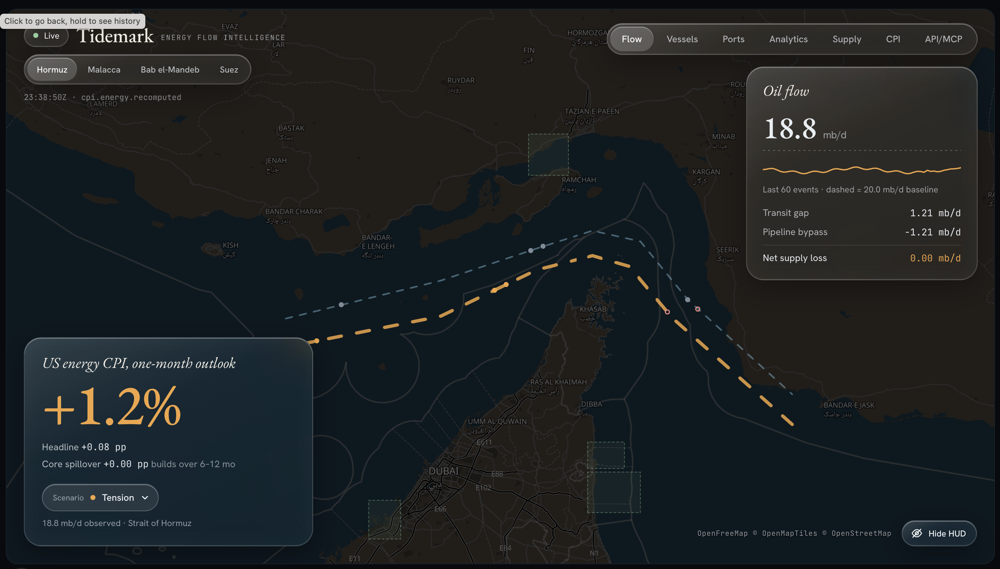
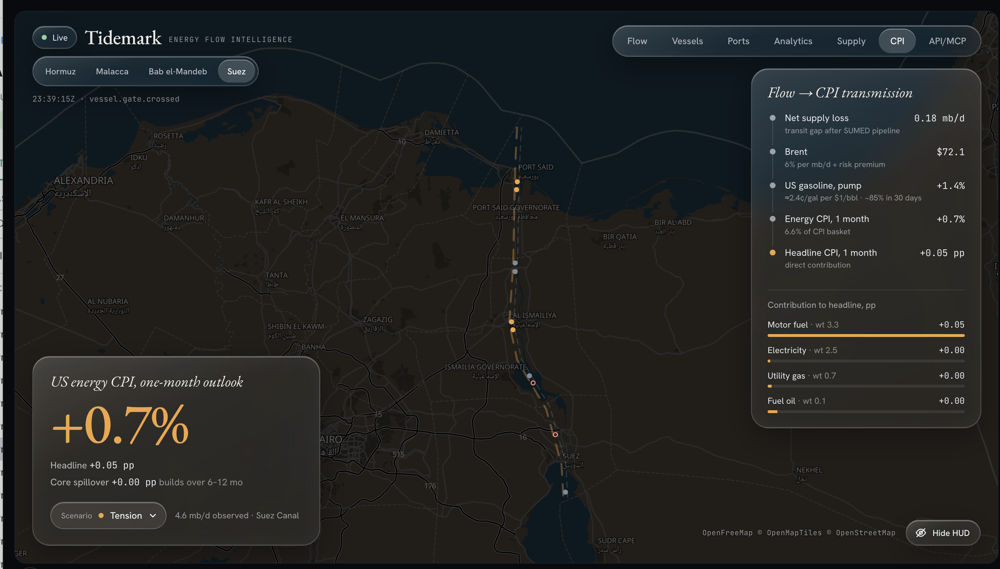
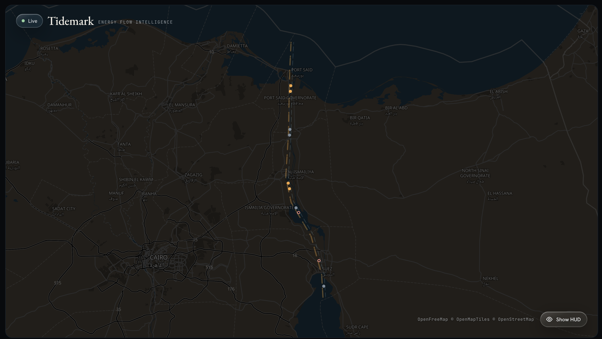

#### 🧠 Neural response analyzer for video creative
An interactive tool that predicts how an average viewer's brain responds to a video ad, second by second. Features a 3D cortical surface with switchable views and inflation controls, a timeline synced to playback, and per-region scores broken down by video, audio, and speech drivers. The model runs locally.

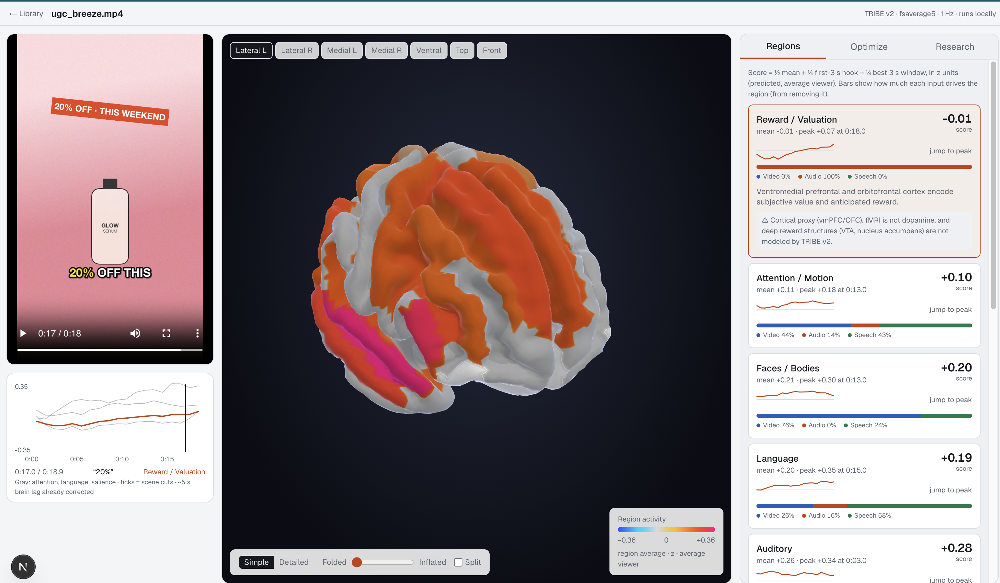

#### 🏗️ AI change order review assistant
An agentic document review platform for construction owners. Contracts, rate sheets, and specifications are ingested and classified automatically, and incoming change order packages are checked against a configurable multi-stage checklist. Answers cite the exact source page.

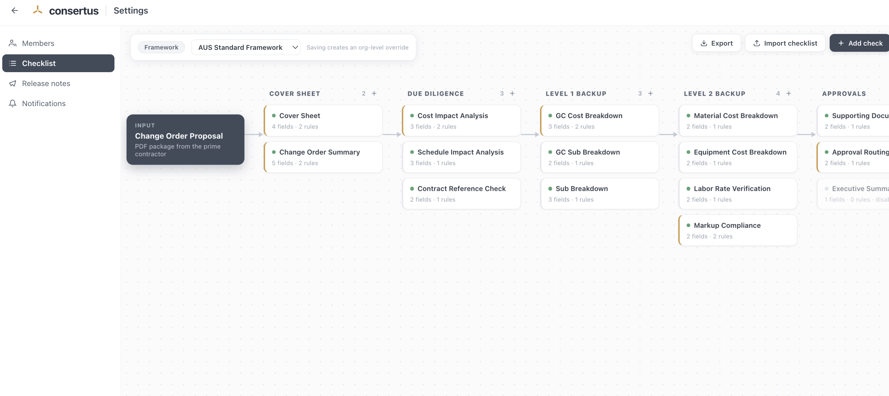
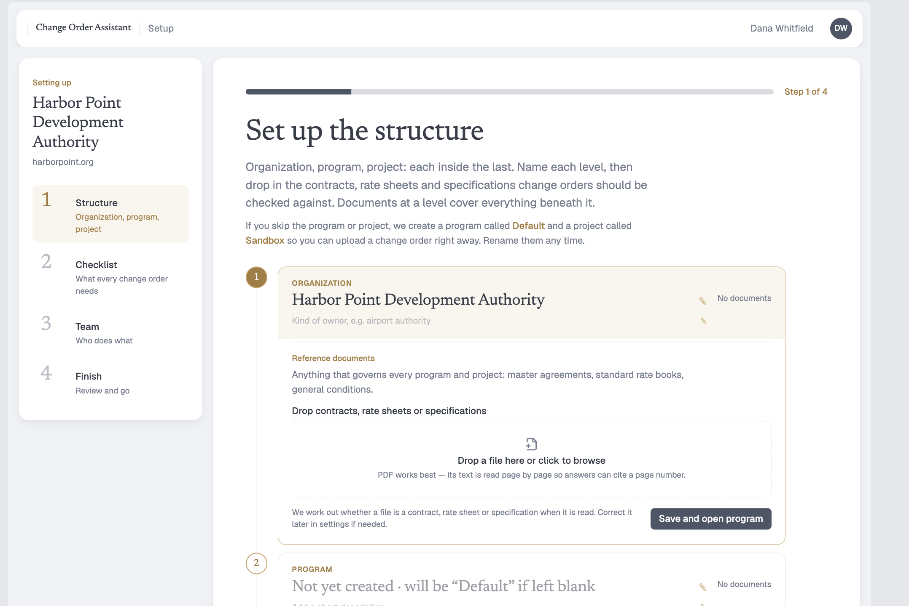

#### 📈 Social trade-card generator
A consumer app that turns cluttered brokerage screenshots from any broker into clean, shareable portfolio cards. AI vision extracts holdings and P&L, and the app adds a community leaderboard, passkey sign-in, QR-based copy-trade links, privacy controls to hide dollar amounts, and rich link unfurls for social sharing.

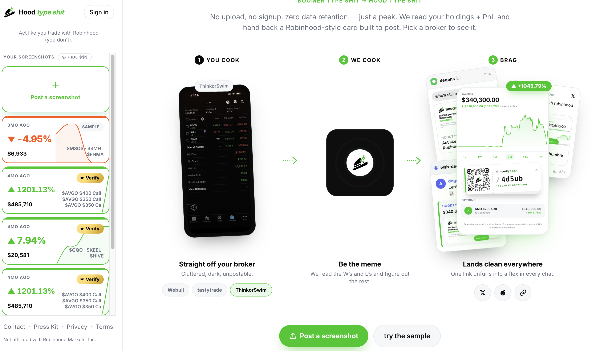
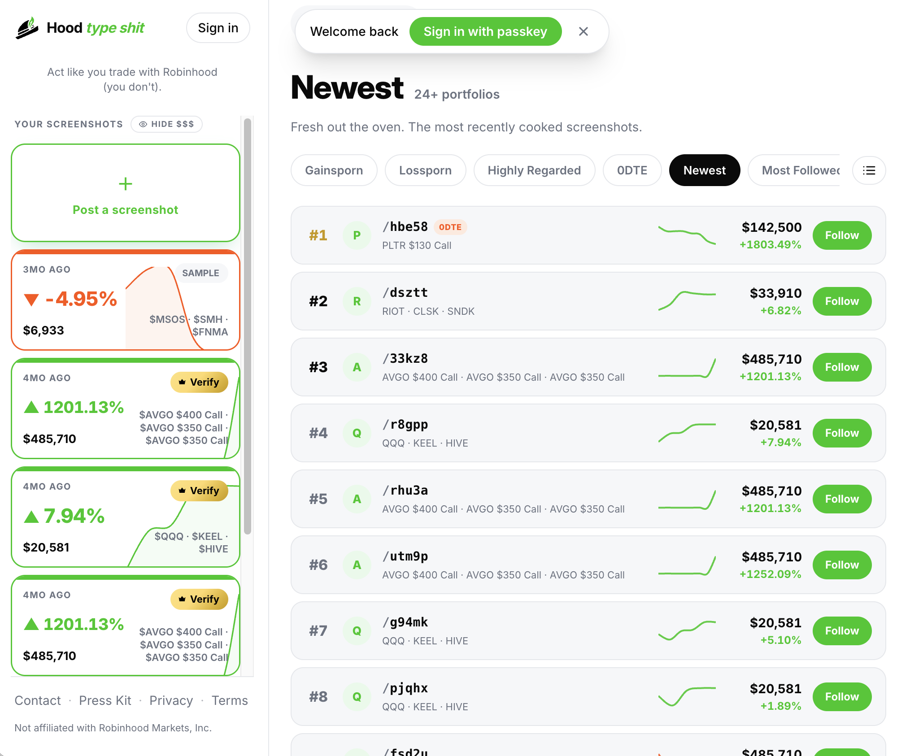 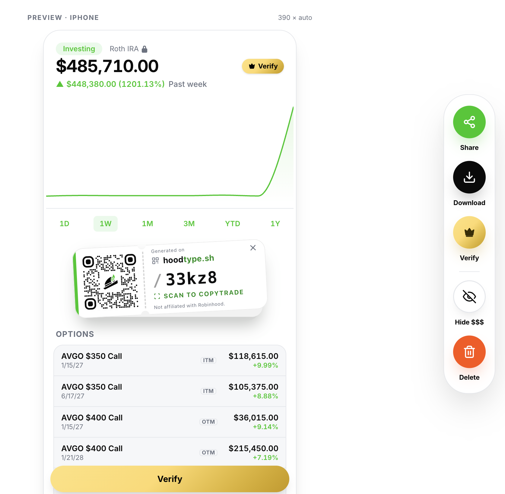
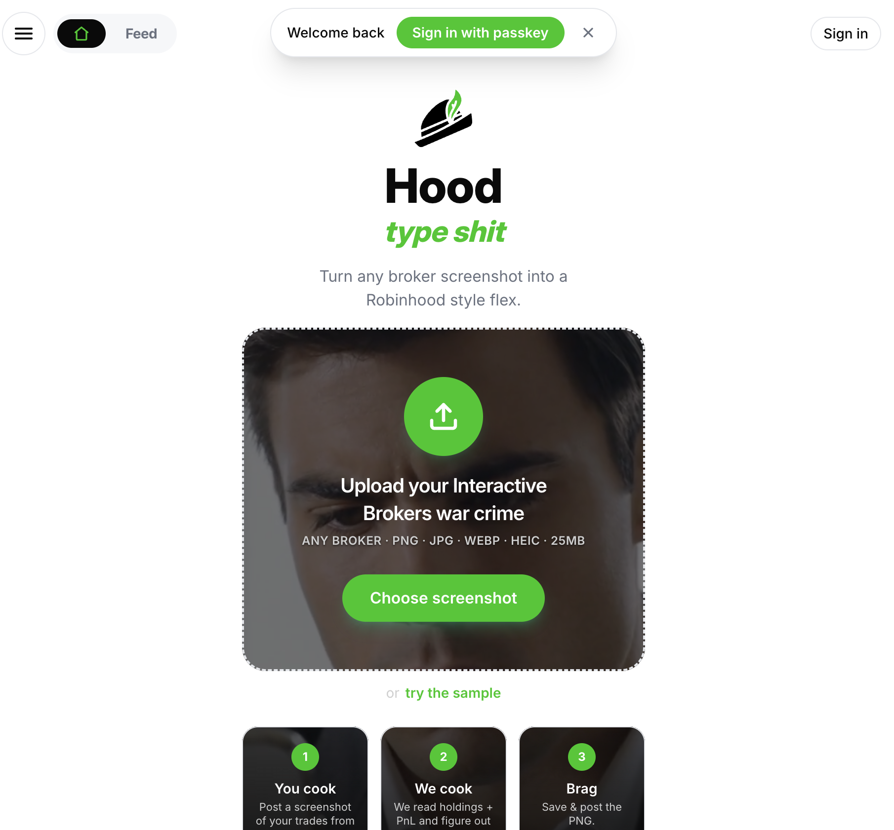

#### 🤖 AI automation agency site
A cinematic landing page for an enterprise workflow automation agency: an animated light-field hero, editorial serif typography, and a rotating case-study card with real outcome metrics.

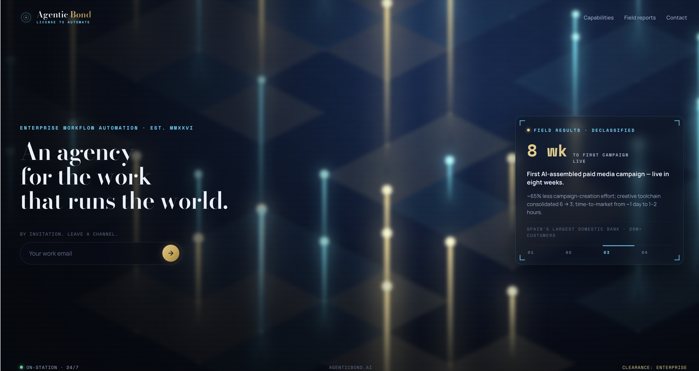

#### 💋 Creator link-in-bio platform
A monetization-first link-in-bio product for creators, with custom handles, branded social links, paid shoutouts, tipping, and earnings at a glance. The marketing site is built around a live phone preview.

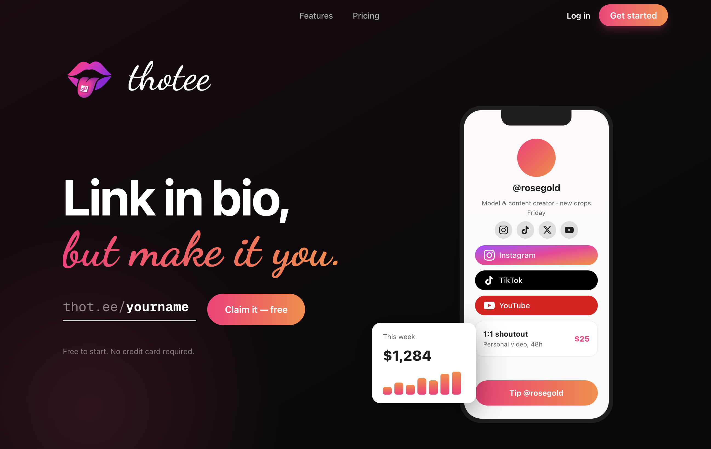

---

### Earlier work: Web3

Before focusing on Web2 and AI products, I built smart contracts and dapps. A few open source highlights:

- [Fully on-chain dynamic SVG NFT (ERC721A, Solidity + assembly)](https://github.com/0xevm1/wrapperfi-contracts)
- [Token airdrop with Merkle trees and EIP-712 signatures](https://github.com/Wrapper-Fi/wrapper-fi-token-distributor-airdrop-ecdsa-merkle)
- [Gas optimization via data packing and bitpacking](https://github.com/0xevm1/chad-dao-solidity-bit-packing)

---

### Let's build something

I'm open to contract and full-time engagements: product teams that need a senior UI/UX-focused engineer, startups that need an MVP shipped, or companies adding agentic workflows to existing products.

📫 **0xevm1 at gmail dot com**
